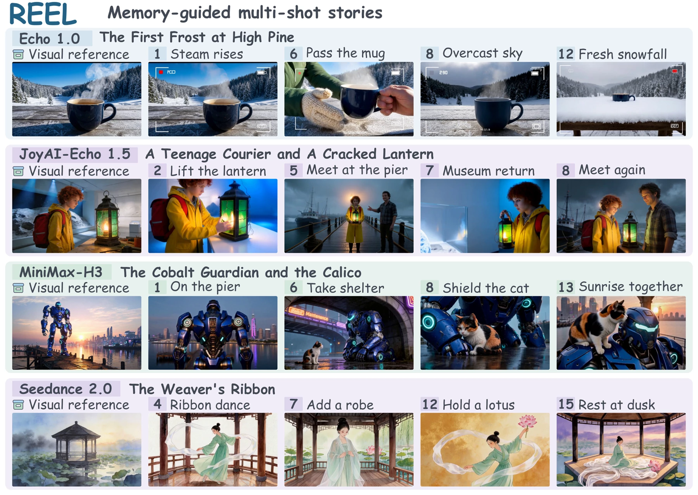

# REEL

### Learning to Retrieve, Evaluate, and Evolve Visual Memory for Any Long-Horizon Multi-Shot Video Generation

**[Project page](https://xuhang07.github.io/REEL/)** · **[Paper](https://xuhang07.github.io/REEL/assets/reel.pdf)** · **Weights: [sft](https://huggingface.co/redflash6/sft) / [singleshotgrpo](https://huggingface.co/redflash6/singleshotgrpo) / [multishotgrpo](https://huggingface.co/redflash6/multishotgrpo)**

Hang Xu¹, Guohui Zhang¹, Xiaoxiao Ma¹, Hu Yu¹, Jie Huang¹, Jiayin Xiao¹, Lin Song², Haoyang Huang², Nan Duan², Feng Zhao²

¹ University of Science and Technology of China · ² JD Explore Academy



REEL is a trainable, tool-using visual-memory planner. It retrieves relevant references, creates missing visual evidence, evaluates video candidates, and updates persistent memory for later shots. Backend-specific adapters translate a shared evidence plan into generator inputs; the video generator is not part of policy learning.

## Repository

| Path | Contents |
| --- | --- |
| `tools/storymem_policy/` | Nine-tool contract, state machine, memory runtime, evidence plans, and SFT export |
| `tools/storymem_adapter/` | JoyAI-Echo 1.5 conditioning and prompt adapters |
| `tools/reel_h3_*.py` | MiniMax-H3 prompt adapter, transport, and collector integration |
| `tools/storymem_teacher/` | Trajectory collection, media utilities, and prompt resources |
| `verl_recipe/storymem_memory_policy_rl/` | Online agent loop, GRPO reward components, preprocessing, and runtime checks |
| `tools/reel_bench/` | Sequential benchmark protocol and evaluation helpers |
| `patches/` | Compatibility patches for the VERL / SGLang runtime |
| `docs/` | Static project website and manuscript table values |

The `storymem_*` module names are retained to preserve implementation imports and schema compatibility; the method is **REEL**. This release contains research code, not a hosted generation service. Planner weights are hosted separately on Hugging Face: SFT step 1034, single-shot GRPO step 100, and multi-shot GRPO step 50. Benchmark inputs and training datasets are not bundled.

## Core setup

Use Python 3.10 or newer. Install the lightweight runtime dependencies and make the tools directory importable:

```bash
python -m pip install -r requirements.txt
export PYTHONPATH="$PWD/tools:$PWD${PYTHONPATH:+:$PYTHONPATH}"
python tools/print_reel_tool_schema.py
```

The last command prints the actual nine-tool JSON schemas without loading weights or contacting a provider. Media processing also requires `ffmpeg` and `ffprobe` on `PATH`.

```bash
python -m pip install -r requirements-dev.txt
python -m pytest -q tools/test_storymem_policy_contract.py tools/test_storymem_policy_state.py \
  tools/test_storymem_adapter_pe.py tools/test_reel_h3_adapter.py tools/test_reel_h3_transport.py
```

## Planner and backend integration

`MemoryPolicyRuntime` in `tools/storymem_policy/runtime.py` enforces the tool protocol and maintains explicit, persistent memory. `StoryCollector` provides the host interaction loop. The JoyAI-Echo and MiniMax-H3 adapters map the same evidence-plan schema to their respective conditioning interfaces.

Generation requires separately deployed backend services and access to their models. Configure your own endpoints and credentials; no provider credentials or internal service addresses are distributed. `REEL_H3_API_URL` selects an H3-compatible service. The H3 file-URI transport expects reference files on the backend's shared filesystem; inspect `H3VideoClient` before integrating a different transport.

The native Qwen3.5 runner is `tools/run_storymem_stbench_qwen35_policy.py`. It requires PyTorch, a Transformers installation with Qwen3.5 support, the associated LLaMA-Factory renderer, a checkpoint, a compatible SFT snapshot, and a benchmark manifest. Once those resources are available, inspect its arguments with:

```bash
python tools/run_storymem_stbench_qwen35_policy.py --help
```

Pass `--model`, `--snapshot`, `--manifest`, and `--output-root` explicitly. `REEL_OUTPUT_ROOT` configures the collector's allowed output parent. Local provider configuration can be supplied through `STORYMEM_MODEL_CONFIG`; `*.local.json` and `.env` files are ignored by Git.

## Training components

REEL uses SFT, single-shot GRPO, and multi-shot GRPO. The released components keep memory-bank and registry state explicit across shots.

- **SFT preparation:** `tools/prepare_storymem_memory_policy_qwen35_sft.py` converts compatible collection trajectories into supervised examples. It requires `--data-root` and `--output-dir`.
- **RL preprocessing:** `verl_recipe/storymem_memory_policy_rl/preprocess.py` and `reel_preprocess.py` prepare episode inputs.
- **Online policy execution:** `online_agent_loop.py` integrates the tool runtime with VERL.
- **Rewards:** `gemini_reward.py`, `reward.py`, and the named reward variants contain the research reward implementations. Select the variant explicitly when configuring a run.
- **Runtime compatibility:** `verify_runtime.py` checks the non-upstream multi-shot contracts needed by the recipe. The patches target VERL 0.8 and SGLang 0.5.10; they are not interchangeable with arbitrary newer versions.

Training additionally requires a compatible VERL environment, Ray, PyArrow, PyTorch, Transformers, a supported serving backend, generation services, and training inputs. Cluster-specific launch scripts and local scheduler configuration are intentionally not distributed. The recipe is an integration component, not a claim that installing the lightweight requirements alone reproduces a full training run.

RL provider keys are read only from `STORYMEM_RL_GEMINI_API_KEY` and `STORYMEM_RL_IMAGE_API_KEY`. Configure those locally; never put secrets in command-line arguments, source files, or commits.

### Public prompt-resource revision

The inherited resource manifest declared the Director v7 shot-prompt writer as SHA-256 `6eb1ec73a339590ec45d0c7b14c9b0988a90022388a91c7f06dac69067a826f6`, but the checked-in source file hashes to `dd95f9058e31c3061ade84b1839dcdd88e0c2ca652e2220c302eec05b4ff09d6`. The public manifest revision `reel-public-20261012` explicitly binds the current file and retains the previously declared hash. The prompt file itself is unchanged. This packaging revision is not evidence of byte identity with a historical training snapshot; use matching resource locks when replaying saved trajectories.

## Evaluation and project-page results

`tools/run_reel_bench.py` accepts a benchmark suite and a command-based adapter. `tools/evaluate_reel_bench.py` and `tools/evaluate_storymem_stbench_official.py` implement the corresponding evaluation workflows. The latter additionally needs VBench/ViCLIP and their feature-extractor weights; supply your own paths or `STORYMEM_VBENCH_ROOT`.

The interactive website reads `docs/results.json`, transcribed from manuscript Tables 1–3. Quality scores average complete, decodable stories; failed and incomplete stories are excluded. Average completed shots is a separate all-attempt metric. The website does not synthesize missing scores or confidence intervals.

## Website development

The site is dependency-free at runtime. GitHub Pages serves `docs/` from the `main` branch at `https://xuhang07.github.io/REEL/`.

```bash
npm run preview
```

To refresh the paper, four web figures, and table values from a local manuscript checkout:

```bash
node scripts/sync-paper.mjs /path/to/paper
node scripts/sync-paper.mjs /path/to/paper --check
```

This command requires Node.js and FFmpeg. It does not modify the manuscript. To run browser checks:

```bash
npm install
npx playwright install chromium
npm run test:site
```

## Citation

```bibtex
@misc{xu2026reel,
  title = {REEL: Learning to Retrieve, Evaluate, and Evolve Visual Memory
           for Any Long-Horizon Multi-Shot Video Generation},
  author = {Hang Xu and Guohui Zhang and Xiaoxiao Ma and Hu Yu and
            Jie Huang and Jiayin Xiao and Lin Song and Haoyang Huang and
            Nan Duan and Feng Zhao},
  year = {2026},
  note = {Preprint},
  url = {https://xuhang07.github.io/REEL/}
}
```

## Licensing and acknowledgments

Existing source notices and the inherited `LICENSE` are preserved. DirectorAgent prompt resources retain their upstream license in `Director_Agent/LICENSE`. This repository does not relicense third-party model weights, datasets, video backends, VERL, SGLang, or LLaMA-Factory. Obtain those dependencies under their respective terms.
